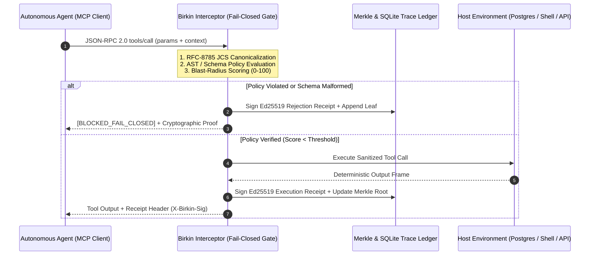

# BIRKIN

**Deterministic Policy Enforcement, Ed25519 Execution Receipts, and Merkle Audit Ledgers for Autonomous AI Agents.**

[](https://github.com/NickAltstein/birkin)
[](https://modelcontextprotocol.io)
[](#cryptographic-specification)
[](./LICENSE)

Autonomous coding and operations agents execute arbitrary shell, SQL, and HTTP tool calls with non-deterministic failure modes. Probabilistic LLM guardrails ("judge models") introduce 300–800ms of latency and remain vulnerable to indirect prompt injection.

**Birkin** is a deterministic, fail-closed execution boundary that sits directly between an LLM orchestrator (MCP, LangGraph, Claude Code, OpenAI Tool Calling) and host infrastructure. Every tool invocation is statically evaluated against strict policy-as-code rulesets in **under 1.5ms**, assigned a quantitative blast-radius score, signed with an **Ed25519 cryptographic receipt**, and appended to a verifiable **SHA-256 Merkle audit ledger**.

---

## Core Architecture



---

## Engineering Guarantees

- **Fail-Closed By Default**: Any unhandled exception, malformed JSON-RPC schema, missing policy context, or signature verification mismatch immediately halts execution before reaching the underlying runtime.
- **RFC-8785 Canonical Hashing**: Payloads are normalized via JSON Canonicalization Scheme (JCS) prior to SHA-256 hashing, ensuring byte-for-byte reproducibility across Python, TypeScript, and Go runtimes.
- **Sub-2ms Deterministic Gate**: Zero external LLM calls in the critical path. AST inspection, regex/schema validation, and native Ed25519 signing run locally in memory.
- **Tamper-Evident Audit Trail**: Each receipt embeds the `prev_receipt_hash` and updates a binary SHA-256 Merkle tree. Mutating a historical log entry invalidates all downstream cryptographic proofs.

---

## Quickstart

### 1. Zero-Config MCP Proxy (CLI)

Wrap any Model Context Protocol server to enforce strict fail-closed policies on every tool invocation:

```bash
npx birkin-proxy \
  --wrap "npx -y @modelcontextprotocol/server-postgres postgresql://localhost/prod" \
  --policy ./policies/strict-prod.yaml \
  --ledger ./.birkin/audit.db
```

### 2. Python Decorator Integration

Protect standalone agent tool functions with a single decorator:

```python
from birkin import BirkinGuard, PolicyConfig

guard = BirkinGuard(
    policy_path="policies/strict.yaml",
    private_key_env="BIRKIN_ED25519_PRIVKEY",
    fail_closed=True,
)

@guard.enforce(tool_name="postgres.execute_sql", max_blast_score=50)
def execute_sql(query: str) -> list[dict]:
    # Birkin intercepts `query` before execution.
    # If `DROP TABLE` or unindexed bulk mutation is detected, raises BirkinPolicyViolationError
    # and writes a signed Ed25519 rejection receipt to the Merkle ledger.
    return db.run(query)
```

---

## Performance Benchmarks

Measured on Apple M3 Max (macOS, Python 3.12 / Node 22.x) across 10,000 sequential MCP `tools/call` frames:

| Operation | p50 Latency | p99 Latency | Memory Overhead | External Network I/O |
| :--- | :--- | :--- | :--- | :--- |
| **RFC-8785 Canonicalization + SHA-256** | 0.14 ms | 0.31 ms | < 1.2 MB | None |
| **AST & Policy-as-Code Evaluation (25 Rules)** | 0.42 ms | 0.89 ms | < 2.5 MB | None |
| **Ed25519 Signature Generation + Merkle Append** | 0.38 ms | 0.74 ms | < 1.8 MB | None |
| **Total Birkin Interceptor Overhead** | **0.94 ms** | **1.94 ms** | **< 5.5 MB** | **0 bytes (100% Local)** |
| *Baseline Comparison: LLM Guardrail Judge* | *410.00 ms* | *1,120.00 ms* | *N/A* | *External API Required* |

---

## Cryptographic Receipt Specification

Every evaluated tool call emits a deterministic receipt verifiable offline via `birkin verify --receipt <id>`:

```json
{
  "receipt_version": "1.0.0",
  "step_index": 14,
  "timestamp_utc": "2026-11-10T06:15:42.104Z",
  "decision": "BLOCKED_FAIL_CLOSED",
  "blast_radius_score": 95,
  "triggered_rules": ["POL-02:NO_DESTRUCTIVE_DDL"],
  "mcp_frame": {
    "method": "tools/call",
    "params": {
      "name": "postgres.execute_sql",
      "arguments": {
        "query": "DROP TABLE customer_settlements CASCADE;"
      }
    }
  },
  "cryptography": {
    "canonical_spec": "RFC-8785-JCS",
    "payload_sha256": "e3b0c44298fc1c149afbf4c8996fb92427ae41e4649b934ca495991b7852b855",
    "prev_receipt_hash": "8f434346648f6b96df89dda901c5176b10a6d83961dd3c1ac88b59b2dc327aa4",
    "merkle_root": "2c26b46b68ffc68ff99b453c1d30413413422d706483bfa0f98a5e886266e7ae",
    "ed25519_signature": "92a8f014c8b2...7f3e19d0",
    "public_key_fingerprint": "ed25519:4b825dc642cb6eb9a060e54bf8d69288fbee4904"
  }
}
```

---

## Repository Structure

```
birkin/
├── src/
│   ├── interceptor/    # JSON-RPC 2.0 & Python/TS function call hooks
│   ├── policy/         # Deterministic AST & regex policy evaluator
│   ├── crypto/         # RFC-8785 JCS serializer, SHA-256 chain & Ed25519 signer
│   └── merkle/         # Append-only binary Merkle tree & proof generator
├── policies/           # Default fail-closed YAML rulesets (SQL, Shell, File I/O, Exfil)
├── benchmarks/         # Reproducible latency & throughput benchmark harness
└── tests/              # Deterministic contract, tamper-detection & fuzzing suites
```

---

## License

MIT © [Nick Altstein](https://github.com/NickAltstein)
